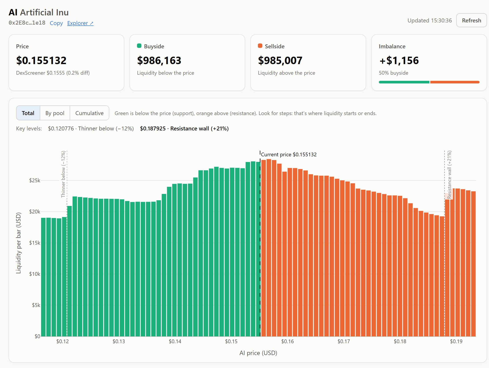

# Liquidity Depth — Robinhood Chain

See where the liquidity for any token on Robinhood Chain
sits, combined across **every Uniswap V3 and V4 pool**, and whether there is
more of it below the current price (buyside) or above it (sellside).



- **Aggregated depth chart.** All V3 and V4 pools are combined on one USD
  price axis. Three views: total liquidity per price level (green below the
  price, orange above), the same split by pool, and an exchange-style
  cumulative depth curve.
- **Key levels.** Price levels where liquidity changes sharply (resistance
  and support walls, or where it thins out) are marked on the chart.
- **Buyside / sellside imbalance.** Shows how much USD liquidity sits below
  and above the current price.
- **Price sanity check.** The computed price is compared against
  DexScreener, with a warning if the two diverge.
- **No API keys.** Everything is read directly from the public RPC.
- **Web UI or CLI.**

## Quick start

Requires Python 3.10+.

```bash
git clone https://github.com/BallesJr/robinhood-liquidity-depth.git
cd robinhood-liquidity-depth
python -m venv .venv
.venv\Scripts\activate          # Windows
# source .venv/bin/activate     # macOS / Linux
pip install -e .
```

### Web UI

```bash
python -m webapp.app
```

Open <http://127.0.0.1:5000>, paste a token address (or pick the example)
and click **Analyze**. An analysis takes about 10–20 seconds, and the page
shows each step as it runs. Repeating the same query within 45 seconds
loads instantly from the cache. On Windows you can also double-click
`launch_app.bat`.

### CLI

```bash
liquidity-depth --token 0x2e8C31162B855a2fFa90F6F8634643aD6F111E18
```

| Flag | Default | Meaning |
|---|---|---|
| `--token` | Artificial Inu ($AI) | ERC-20 token address to analyze |
| `--window` | `0.5` | Price window as a fraction (`0.5` = ±50%) |
| `--bins` | auto | Number of chart bars; by default picked from how fine the token's liquidity is |
| `--output` | `liquidity_depth.png` | Where to save the chart |
| `--no-chart` | off | Print the summary only |
| `--no-cache` | off | Ignore the V4 pool cache and rescan from block 0 |
| `--view` | `total` | Chart style: `total` (colored by side) or `pool` (stacked by pool) |
| `--show` | off | Open the chart in a window |
| `-v` | off | Verbose logging |

> The web UI's window field is in **percent** (`50` = ±50%). The CLI's
> `--window` flag is a **fraction** (`0.5` = ±50%).

## How to read it

**Buyside $** is the USD value of liquidity below the current price.
**Sellside $** is the USD value above it. **Imbalance** is buyside minus
sellside.

This is concentrated AMM liquidity, **not a limit-order book**, and it
doesn't predict where the price will go. Pools quoted in tokens without a
USD price feed are listed in the table but left out of the chart. See
[docs/METHODOLOGY.md](docs/METHODOLOGY.md) for the full method, its
limitations, and how every contract address was verified on-chain.

## Configuration

The defaults work without any changes. To override the RPC URL, quote
tokens, window or performance settings, copy `.env.example` to `.env` and
edit it. If you add a quote token, also add a USD price source for it in
`liquidity_depth/tokens.py`.

## Project layout

```
liquidity_depth/      Core library + CLI
  aggregation.py        Pipeline: pools -> per-pool liquidity -> USD bins -> imbalance
  pools_v3.py           V3 discovery and tick reads
  pools_v4.py           V4 discovery (Initialize events) and extsload-based reads
  liquidity_math.py     Tick/price conversions, amounts from liquidity
  rpc_utils.py          JSON-RPC batching, retries, log-range bisection
  tokens.py             ERC-20 metadata and quote-token USD prices
  price_check.py        DexScreener cross-check
  visualize.py          Matplotlib (CLI) and Plotly (web) charts
  config.py             Verified addresses and tunables (overridable via .env)
webapp/               Flask web UI
tests/                Offline unit tests
docs/                 Methodology and deployment guides
```

## Development

```bash
pip install -e ".[dev]"
pytest          # offline unit tests (math, price feeds, web API)
ruff check .    # lint
```

CI runs both on every push (`.github/workflows/ci.yml`).

## Deploying

To host the web UI at a public URL (Render or Railway), see
[docs/DEPLOY.md](docs/DEPLOY.md).

## Disclaimer

This is an analytics tool, not financial advice. On-chain data and
external price feeds can be wrong or stale, so check before acting on
anything it shows.

## License

[MIT](LICENSE)
